# Isaac for Healthcare - Workflows

[](https://docs.isaacsim.omniverse.nvidia.com/6.2.0/index.html)
[](https://docs.python.org/3/)
[](LICENSE)
[](https://github.com/isaac-for-healthcare/i4h-workflows/actions/workflows/pre-commit.yml)

Healthcare robotics workflows as IsaacLab-Arena environments: the scenes, robots, success criteria, policies, and teleoperation devices for each procedure, run with the tools Isaac Lab and IsaacLab-Arena users already have.

Each workflow is an i4h scene that runs as an IsaacLab-Arena environment. Arena's policy runner evaluates a rule-based controller or a policy checkpoint in it, Isaac Lab's `record_demos.py` and `replay_demos.py` record and replay demonstrations, and each policy checkpoint is served from its own environment by its stack's own server.

## Layout

The repository has six main components:

- `arena/` — the scenes as IsaacLab-Arena environments, with their embodiments, policies, teleoperation devices, and operator UI
- `common/` — scene and task manifests, robot descriptors, and the recording schema
- `tasks/` — policy stacks (GR00T, openpi), each with its server, fine-tuning, and task manifests
- `rl/` — reinforcement learning profiles and trainers
- `tools/` — dataset processing and visualization tools
- `docs/workflows/` — each specialty's workflows, environments, and commands

See [DESIGN.md](DESIGN.md) for detailed architecture and ownership rules.

## Requirements

- Ubuntu 22.04 or 24.04 on `x86_64` or `aarch64`
- RTX-capable NVIDIA GPU with 16 GB VRAM minimum for Isaac Sim; 48 GB recommended for i4h workflows
- Linux driver `595.58.03` (the Isaac Sim 6.2 tested version) or a compatible newer production-branch driver
- Some training profiles require more VRAM or multiple GPUs; see the workflow-specific documentation
- `uv` and `git`
- CUDA Toolkit 12.x or 13.x, no newer than the driver supports, for endoluminal RL (CUDA fluoroscopy by default) or the standalone `xray-simulator` CLI; the endoluminal environments otherwise render patient-CT fluoroscopy on Vulkan. See [TROUBLESHOOTING.md](TROUBLESHOOTING.md#failed-to-create-device-from-slang-fluoroscopy)
- Network access for Python packages, third-party checkouts, models, and assets
- Tens of GB for dependencies, plus additional model-cache space (large checkpoints such as GR00T N1.7 can require several dozen GB)
- Optional for natural-language prompts: Claude Code, Codex, or the repository's [Local Agent](local-agent/README.md). Tested with Opus 4.8 (1M context) and GPT-5.5 at low or medium reasoning effort.

## Supported Workflows

Workflows are organized by clinical robotics specialty. Each specialty page lists its workflows' IsaacLab-Arena environments and commands.

`✓` means available, `—` means unavailable, and “RL training required” means you must train and export a policy first.

### [Laparoscopic Robotics](docs/workflows/laparoscopic-robotics.md)

| Preview | Workflow | Purpose | Robot | Policy readiness | Rule-based |
| --- | --- | --- | --- | --- | --- |
| 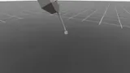 | [`surgical_lift_block`](docs/workflows/laparoscopic-robotics.md) | Grasp and lift a peg-transfer block. | dVRK PSM | — | ✓ |
| 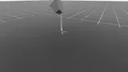 | [`surgical_lift_needle`](docs/workflows/laparoscopic-robotics.md) | Grasp and lift a suture needle. | dVRK PSM | — | ✓ |
|  | [`surgical_lift_needle_organs`](docs/workflows/laparoscopic-robotics.md) | Lift a suture needle from an organ bed. | dVRK PSM | — | ✓ |
| 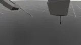 | [`surgical_reach_dual_psm`](docs/workflows/laparoscopic-robotics.md) | Reach two targets with two arms. | dual dVRK PSM | — | ✓ |
| 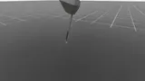 | [`surgical_reach_psm`](docs/workflows/laparoscopic-robotics.md) | Reach a target with one PSM arm. | dVRK PSM | — | ✓ |
| 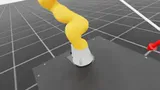 | [`surgical_reach_star`](docs/workflows/laparoscopic-robotics.md) | Reach a target with a STAR arm. | STAR | — | ✓ |

### [Ultrasound Robotics](docs/workflows/ultrasound-robotics.md)

| Preview | Workflow | Purpose | Robot | Policy readiness | Rule-based |
| --- | --- | --- | --- | --- | --- |
| 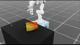 | [`ultrasound_liver_scan`](docs/workflows/ultrasound-robotics.md) | Sweep an ultrasound probe across an abdominal phantom. | Franka-style arm | ✓ openpi PI0 | ✓ |
|  | [`ultrasound_probe_reach`](docs/workflows/ultrasound-robotics.md) | Align a probe with a randomized target. | Franka-style arm | RL training required | — |

### [Endoluminal Robotics](docs/workflows/endoluminal-robotics.md)

| Preview | Workflow | Purpose | Robot | Policy readiness | Rule-based |
| --- | --- | --- | --- | --- | --- |
| 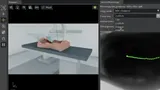 | [`endoluminal_navigation`](docs/workflows/endoluminal-robotics.md) | Navigate a catheter with live fluoroscopy. | XPBD catheter + orbital C-arm | — | — |
|  | [`endoluminal_navigation_arm`](docs/workflows/endoluminal-robotics.md) | Navigate a catheter carried on a Franka Panda flange with live fluoroscopy. | Franka Panda + XPBD catheter + orbital C-arm | GR00T N1.7 training required | — |

### [Hospital Automation Robotics](docs/workflows/hospital-automation-robotics.md)

| Preview | Workflow | Purpose | Robot | Policy readiness | Rule-based |
| --- | --- | --- | --- | --- | --- |
| 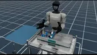 | [`assemble_trocar`](docs/workflows/hospital-automation-robotics.md) | Assemble and place a trocar. | Unitree G1 + dex hands | ✓ GR00T N1.5 | — |
| 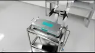 | [`locomanip_push_cart`](docs/workflows/hospital-automation-robotics.md) | Walk to and push a cart. | Unitree G1 | ✓ GR00T N1.6 | — |
| 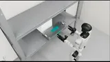 | [`locomanip_tray_pick_and_place`](docs/workflows/hospital-automation-robotics.md) | Move a surgical tray from a shelf to a cart. | Unitree G1 | ✓ GR00T N1.6 | — |
| 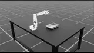 | [`scissor_pick_and_place`](docs/workflows/hospital-automation-robotics.md) | Pick up scissors and place them in a tray. | SO-ARM 101 | ✓ GR00T N1.5 / N1.7 | ✓ |
| [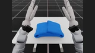](docs/workflows/images/spread_tablecloth_g1.webp) | [`spread_tablecloth_g1`](docs/workflows/tablecloth.md) | Tablecloth spreading via XR hand tracking. | Unitree G1 + Inspire hands | — | — |
| [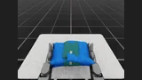](docs/workflows/images/spread_tablecloth_h2.webp) | [`spread_tablecloth_h2`](docs/workflows/tablecloth.md) | Tablecloth spreading via XR hand tracking. | Unitree H2 + Sharpa hands | — | — |

PhysX is the default physics backend except for the tablecloth workflows, which use coupled Newton cloth physics. The laparoscopic workflows also support Newton physics. `assemble_trocar` also provides an RLinf PPO post-training profile.

## Use with an AI Agent

Use this interface with Claude Code, Codex, or the repository's [Local Agent](local-agent/README.md). Describe the outcome you want; the agent selects the appropriate repository skill, resolves the direct commands, performs the work, and reports validation evidence. Setup, execution, authoring, and the data-to-policy pipeline can all be requested through prompts.

### Setup with an AI Agent

```text
What does the i4h workflow include, and where should I start?
Set up the i4h workflow on this machine and tell me if any host requirements are missing.
```

The agent checks host requirements, installs or repairs the repository dependencies, and reports anything that still blocks execution.

### Run Workflows with an AI Agent

Choose this path when one of the supported workflows already matches the robot, scene, and task you want to run. Give each prompt separately so follow-up requests such as replay and annotation can use recordings produced by the preceding evaluation.

```text
Evaluate scissor pick and place in policy mode and record 2 successful episodes.
Replay the second episode.
Run annotation on all recorded episodes and summarize.

Evaluate ultrasound_liver_scan in policy mode for 1 episode.
Evaluate trocar assembly in policy mode for 1 episode.
Evaluate locomanip tray pick and place in policy mode for 1 episode.
Evaluate locomanip push cart in policy mode for 1 episode.

Run surgical_reach_psm in rule-based mode for 1 episode.
Run surgical_reach_psm in rule-based mode for 1 episode with Newton physics.
Run surgical_lift_needle in rule-based mode for 1 episode.
```

### Author New Workflow with an AI Agent

Start with an empty scene, then add the robot and its behavior, define the goal, and add the ways to run it.

```text
create a new workflow with an empty scene
          ↓
edit the scene: add assets, robot, cameras, layout, physics
          ↓
add a rule-based policy for the behavior
          ↓
define the goal + success condition
          ↓
add the ways to run it: rule-based, teleop, replay, policy
          ↓
validate each one in the simulator
```

A scene owns the simulated world, its robot, and its success condition, and runs as an IsaacLab-Arena environment. A rule-based controller is an Arena policy; a trained checkpoint runs behind its stack's server with an Arena client policy.

Issue the following prompts in order. Each prompt completes one ownership boundary before the next stage depends on it:

```text
Create a blank hospital-automation-robotics workflow named my_workflow.

Edit my_workflow live.
  - Add a surgical table.
  - Add scissors and tweezers on the table.
  - Add two destination trays named tray_a and tray_b.
  - Add a Unitree G1 robot.
  - Move G1 so its base starts 2 m from the nearest table edge.
  - Keep G1 upright and facing the center of the table.
  - Set the perspective view to frame the room, then add a room camera from that view.
  - Visually verify that the tabletop, scissors, tweezers, and both trays are visible in at least one camera.
  - Bake all changes and stop.

Continue authoring my_workflow with a rule-based G1 reach-table Task.
  - Behavior: have G1 walk forward and stop near the surgical table.

Define the goal and success condition for my_workflow.
  - Goal: G1 reaches the surgical table.
  - Success: G1 stops upright within 0.3 m of the nearest table edge.

Add these run modes to my_workflow:
  - rule-based
  - trainable GR00T N1.6 policy
Validate the rule-based rollout and statically validate all modes.

Run and record 5 successful rule-based episodes for my_workflow.
Convert and visualize the recorded data.
Fine-tune for 200 steps with a batch size of 32. Turn off vision tuning.
Evaluate the new checkpoint.
Stop all
```

### Author New Workflow with an RL Policy using an AI Agent

Online RL is a separate training lifecycle. It trains a policy against a scene's environment, then returns the verified checkpoint for policy evaluation under Arena's policy runner.

```text
create a blank scene
          ↓
author and validate the scene
          ↓
define the RL objective: observations + actions + rewards + success + resets
          ↓
train from scratch or RL post-train a pretrained policy
          ↓
evaluate the policy in vectorized simulation
          ↓
export the trained checkpoint
          ↓
evaluate it in the environment under Arena's policy runner
```

Issue these prompts in order:

```text
Create a blank ultrasound-robotics workflow named robotic_instrument_reach.

Edit robotic_instrument_reach live.
  - Add a table and a surgical training pad.
  - Add a Franka-style arm with a probe attached to its tool frame.
  - Add a target marker on the pad and a room camera.
  - Frame the arm, probe, pad, and target in the camera view.
  - Visually verify that the arm, probe, pad, and target are visible in the room camera.
  - Bake all changes and stop.

Add an RL training objective to robotic_instrument_reach.
  - Goal: move the probe tip to the marked point on the training pad.
  - Observe the robot joints, probe pose, and target pose.
  - Control the probe with end-effector pose actions.
  - Reward reducing tip-to-target distance, with a small penalty for abrupt actions.
  - Sample a reachable target position on the pad at reset.
  - Success: hold the probe tip within 2 cm of the target for 20 steps.
  - Use PPO and run a small vectorized smoke configuration first.
  - Dry-run the training configuration.

Train the robotic_instrument_reach policy with RL and evaluate 20 randomized episodes.
Export the verified checkpoint.
Validate robotic_instrument_reach in policy mode and report its simulator success rate.
```

`ultrasound_probe_reach` demonstrates PPO training from scratch. `assemble_trocar` demonstrates RL post-training from a GR00T checkpoint. The agent resolves the appropriate profile, trainer, export, and policy-runner validation path.

## Use from the Command Line

Use this interface when running, debugging, scripting, or integrating the workflows without an agent. Run commands from the repository root.

### Setup from the Command Line

```bash
./setup.sh
```

This is the command-line equivalent of asking an AI agent to set up the repository.

Container builds, DGX Spark, Jetson AGX Thor, and sibling vLLM usage are documented in the [Docker guide](docker/README.md). On `aarch64` hosts, apply the OpenMP preload Isaac Sim and torch need before launching anything that runs Isaac Sim:

```bash
eval "$(python3 rl/i4h_rl/runtime.py --shell)"
```

### Run Workflows from the Command Line

Every workflow runs as an IsaacLab-Arena environment under Arena's policy runner, with Isaac Lab's `record_demos.py` and `replay_demos.py` for teleoperation and replay. Each specialty page lists its workflows' commands; for example:

```bash
# Pick and place the scissors with the rule-based controller for 3 episodes.
arena/.venv/bin/python -m isaaclab_arena.evaluation.policy_runner \
  --policy_type i4h_arena.policies.scissors.ScissorPickPlacePolicy --num_episodes 3 \
  --external_environment_class_path i4h_arena.environments:SoarmScissors soarm_scissors

# Reach a target with a dVRK PSM on Newton physics and watch it.
arena/.venv/bin/python -m isaaclab_arena.evaluation.policy_runner \
  --policy_type i4h_arena.policies.reach.CartesianReachPolicy --num_episodes 1 --viz kit --presets newton \
  --external_environment_class_path i4h_arena.environments:PsmReach psm_reach
```

Launcher options such as `--presets newton`, `--enable_cameras`, and `--viz kit` go before the environment name, the environment's own options after it. Policy checkpoints run in their own environments behind a policy server; Arena's runner connects to it as a client (see each specialty page). Each episode ends on its environment's success term or after the step budget its workflow was validated with. Stop a run with Ctrl+C, or a background run or policy server by its process ID.

<!-- markdownlint-disable MD033 -->

<details>
<summary>Show workflow authoring instructions</summary>

### Author New Workflow from the Command Line

Create a blank scene:

```bash
./scripts/create_blank_environment.py my_workflow --validate
```

The generator creates the scene source, asset source, scene manifest, and a contract test, and stops without writing files if the scene already exists. The scene is an IsaacLab-Arena environment from then on, under its name in CamelCase:

```bash
arena/.venv/bin/python -m isaaclab_arena.evaluation.policy_runner \
  --policy_type zero_action --num_steps 300 --viz kit \
  --external_environment_class_path i4h_arena.environments:MyWorkflow my_workflow
```

Use `--dry-run` to preview the files or `--description TEXT` to customize the scene description. Do not combine `--dry-run` with `--validate`.

#### Edit the Scene Live

Edit the generated source directly, or keep one simulator session open while iterating visually. The bridge opens the scene in a Kit window with its timeline paused and Isaac Sim's Python server listening:

```bash
./local-agent/bridge.sh start my_workflow
```

Run individual edits from a second terminal:

```bash
arena/.venv/bin/python scripts/live_scene_edit.py add-known-asset \
  --asset surgical_table \
  --prim-path /World/envs/env_0/Table
```

When the scene is ready, export it and capture reusable authoring facts in the bridge's run directory, then stop the session:

```bash
RUN_DIR="$(./local-agent/bridge.sh rundir my_workflow)"

arena/.venv/bin/python scripts/live_scene_edit.py export-scene \
  --workflow my_workflow \
  --root-path /World/envs/env_0 \
  --output-path "$RUN_DIR/live_scene.json"

arena/.venv/bin/python scripts/authoring_info.py snapshot \
  my_workflow "$RUN_DIR/live_scene.json"

./local-agent/bridge.sh stop my_workflow
```

These files are run artifacts, not scene source. Apply the confirmed scene, asset, and manifest changes to their owning source files. Run `scripts/live_scene_edit.py --help` to list the available live operations.

#### Add the Robot, Goal, and Policies

1. Declare the scene's capabilities in `arena/i4h_arena/scenes/manifest/<scene>.yaml`, including its embodiment and its step budget.
2. Build the robot, the observations, and the success termination in the scene's IsaacLab-Arena embodiment and task under `arena/i4h_arena/`.
3. Add a rule-based controller as an Arena policy (a `PolicyBase` subclass) under `arena/i4h_arena/policies/`, and a teleoperation device as an Isaac Lab device in the scene's `teleop_devices`.
4. For a trained checkpoint, add or reuse a task manifest under `tasks/<stack>/` and an Arena client policy that builds its requests.
5. Add focused CPU tests under `arena/tests/` or the owning stack.

#### Validate the Workflow

Run the scene's contract test and the scene tests, then a visible simulator run of each way to run it:

```bash
common/.venv/bin/python -m pytest tests/test_my_workflow_contract.py -q
arena/.venv/bin/python -m pytest arena/tests/test_scene.py -q
arena/.venv/bin/python -m isaaclab_arena.evaluation.policy_runner \
  --policy_type <your rule-based policy> --num_episodes 1 --viz kit \
  --external_environment_class_path i4h_arena.environments:MyWorkflow my_workflow
```

### Author New Workflow with an RL Policy from the Command Line

Online RL trains a policy against a scene's environment, then returns the verified checkpoint for policy evaluation under Arena's policy runner. Author and validate the scene before adding RL.

#### Define the Training Contract

1. Define observations, actions, rewards, resets, success, and termination in the scene's Arena task.
2. Add `rl/profiles/<workflow>.yaml` and a trainer configuration under `rl/config/`.
3. Add `rl/i4h_rl/adapters/<workflow>.py` only when the backend needs scene-specific conversion or registration.

#### Train and Export the Policy

List the maintained profiles, inspect one, and dry-run its configuration:

```bash
./train.sh rl list

./train.sh rl show ultrasound_probe_reach
./train.sh rl ultrasound_probe_reach \
  --num-envs 128 --epochs 400 --dry-run

./train.sh rl show assemble_trocar
./train.sh rl assemble_trocar \
  --model-path /absolute/path/to/gr00t-sft-checkpoint \
  --num-envs 64 --epochs 1000 --dry-run
```

After the dry run succeeds, repeat the training command without `--dry-run`. Evaluate the native checkpoint and export it:

```bash
./train.sh rl <workflow> \
  --eval --checkpoint <checkpoint-or-run> --episodes 20

./train.sh rl export <workflow> \
  --checkpoint <checkpoint-or-run> \
  --output-dir <export-directory>
```

Then evaluate the checkpoint in the environment under Arena's policy runner: an RSL-RL checkpoint with Arena's `rsl_rl` policy (see [Ultrasound Robotics](docs/workflows/ultrasound-robotics.md#rl-training)), and an exported GR00T checkpoint behind its stack's server with the matching Arena client policy (see [Assemble trocar RL post-training](docs/workflows/hospital-automation-robotics.md#assemble-trocar-rl-post-training), which also documents the two-GPU runtime). `ultrasound_probe_reach` demonstrates RSL-RL PPO training from scratch; `assemble_trocar` demonstrates RLinf post-training from a GR00T checkpoint.

The trainer owns vectorized stepping only while learning. Do not add RL optimization or simulator stepping to a policy or scene.

</details>

<!-- markdownlint-enable MD033 -->

## Run the End-to-End Pipeline

With an AI agent:

```text
Run end-to-end smoke pipeline for scissor pick-and-place.
```

From the command line:

```bash
./scripts/e2e/run.sh --env scissor_pick_and_place --dry-run
./scripts/e2e/run.sh --env scissor_pick_and_place
```

The runner streams progress to the terminal and prints the exact per-run `workflow.log` path. It performs setup, policy recording, mimic expansion, VLM filtering, replay, LeRobot conversion, visualization, fine-tuning, and checkpoint validation. Use its `--skip-*` flags to omit optional stages, and `--headless` on a host without a display.

VLM filtering grades each episode against the `annotate` block of the scene manifest (`arena/i4h_arena/scenes/manifest/<scene>.yaml`), which names the visible success criterion, the cameras to show, and whether to judge the final state or the motion; a scene without one is graded on its policy task's prompt. Fine-tuning needs no Weights & Biases account: PI0 logs there only with `--wandb` or `train.wandb: true` in its task manifest, and GR00T logs to TensorBoard.

## Further Documentation

- See the [troubleshooting guide](TROUBLESHOOTING.md) for setup, policy-backend, determinism, and Docker failures.
- See the individual links in the [workflow catalog](#supported-workflows) for workflow-specific setup and usage.
- See [DESIGN.md](DESIGN.md) for the architecture and ownership rules.
- Use the repository skills under `skills/` for AI-agent workflows. Generic Isaac Sim scene, physics, camera, USD, rendering, and spatial-authoring work routes through the upstream skills selected by [`i4h-workflow-scene-edit`](skills/i4h-workflow-scene-edit/references/isaacsim-skill-routing.md).
