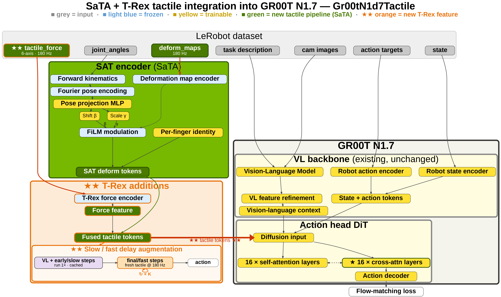

# H2 tactile manipulation with GR00T N1.7

A Unitree H2 with two SharpaWave hands, driven by a GR00T N1.7 policy that is
conditioned on fingertip tactile data: ten deformation maps and ten 6-axis
force histories condition the action head next to vision, state and
language. The pipeline runs on the real robot. It is temporarily not connected
to the simulation workflows in this repository, because no Isaac Sim scene
produces SharpaWave tactile data yet; the task declares what such a scene
would have to provide, and the rest of the stack is written so that nothing
changes when one appears.

This document describes the stack that the structure-first draft under
[`tasks/gr00t_n17_tactile`](../../tasks/gr00t_n17_tactile/README.md) and
[`tools/tactile`](../../tools/tactile/README.md) lays out. The code follows in
smaller pull requests; what each file already does is listed in the project
README.

## The model

- **Two tactile signals per fingertip.** A frozen SharpaWave encoder turns the
  240x240 deformation map into 512 features. A frozen T-Rex VQ-VAE turns the
  last 16 frames of 6-axis force into a 256-d code. The two are concatenated
  per fingertip, modulated (FiLM) and positioned by the fingertip's pose, which
  forward kinematics computes on the hand joints recorded with the frame, so
  the features say *what* is felt and *where*.
- **Zero-initialised cross-attention.** The per-fingertip features enter the
  N1.7 action head through an additional cross-attention in each of its 16 cross-attention
  blocks whose output projection starts at zero. A freshly patched checkpoint
  is numerically the vanilla one; finetuning moves the tactile weights.
- **Delay augmentation.** Training shifts the tactile stream by a random delay
  of up to 16 frames and conditions on whether the flow time is past
  `tau_split`. Tactile dropout keeps the vision-only behaviour of the same
  checkpoint usable.
- **Fresh tactile at inference.** Because of the augmentation, the server can
  re-read the live stream once per denoising step instead of once per chunk,
  and the slow/fast cascade re-plans the tail of a chunk with fresher data
  while the vision-language embeddings stay cached.

## Hardware

- Unitree H2 humanoid, upper body in use: two 7-DoF arms and two SharpaWave
  hands with 22 joints each.
- SharpaWave fingertip sensors, five per hand: a 240x240 single-channel
  deformation map and a 6-axis force reading per fingertip, maps at the policy
  rate (30 Hz) and force at up to 180 Hz.
- Three cameras: one head camera (`high`) and one wrist camera per hand
  (`left_wrist_view`, `right_wrist_view`).
- The SharpaWave SDK runs on the robot's onboard computer. A small bridge next
  to it republishes every fingertip frame over ZMQ in the layout of
  `tactile/sensor/wire.py`; the policy server subscribes to that stream.

## From recording to policy

1. **Teleoperate and record.** XR teleoperation of the H2 with the SharpaWave
   hands and synchronized tactile capture live in the public
   [xr_teleoperate fork](https://github.com/binliunls/xr_teleoperate):
   [recording for Sharpa hands (#7)](https://github.com/binliunls/xr_teleoperate/pull/7),
   [tactile capture (#12)](https://github.com/binliunls/xr_teleoperate/pull/12) and
   [aligned 180 Hz capture (#15)](https://github.com/binliunls/xr_teleoperate/pull/15),
   built on [unitreerobotics/xr_teleoperate](https://github.com/unitreerobotics/xr_teleoperate).
   That tooling is referenced, not vendored.
2. **Convert to LeRobot.** The
   [converter](https://github.com/binliunls/unitree_lerobot/tree/haochens/feat-tactile-180hz)
   writes a LeRobot v2.1 dataset with the tactile columns below and aligns the
   180 Hz force stream causally to the 30 Hz policy rows. `i4h-tactile convert`
   prints its invocation; `i4h-tactile inspect` checks the result.
3. **Finetune.** `i4h-tasks-gr00t-n17-tactile-train --dataset <dir>` derives the
   launcher arguments from the task manifest: base model, modality config, the
   frozen encoders by their public source, force window, delay augmentation.
   `--dry-run` prints them. `--no-tactile` trains the vision-only baseline on
   the same data.
4. **Serve and deploy.** `i4h-tasks-gr00t-n17-tactile --checkpoint <dir>` serves
   the checkpoint over Isaac-GR00T's `PolicyServer` protocol. A client on the
   workstation collects cameras and joint state, sends an observation, and
   executes the returned chunk; the server reads the tactile stream itself, so
   the client never touches tactile data. `--print-server-info` shows what the
   server tells a client on connect.

## Data format

A tactile dataset is an ordinary LeRobot v2.x dataset plus these per-frame
features, declared under `tactile` and `tactile_force` in `meta/modality.json`.
`meta/info.json` must name a `tactile_path` so the loader decodes the maps.

| Feature | Type | Shape | Meaning |
| --- | --- | --- | --- |
| `observation.images.{cam_left_high,cam_left_wrist,cam_right_wrist}` | video | 480 x 640 x 3 | head and wrist cameras |
| `observation.state`, `action` | float32 | 58 | left arm (7), right arm (7), left hand (22), right hand (22) |
| `observation.tactile.<fingertip>` | video | 240 x 240 x 1 | one deformation map per fingertip, ten features |
| `observation.tactile.force` | float32 | 60 | ten fingertips x six axes, at the policy rate |
| `observation.tactile_180.force` | float32 | 6 x 60 | the six 180 Hz force samples before each row (archival; not consumed by this stack yet) |

Fingertips are ordered left thumb, index, middle, ring, pinky, then the right
hand in the same order, everywhere: dataset columns, model inputs, the live
stream after the subscriber has mapped the sensor's channel numbering.

## The sensor interface

What the policy needs from a tactile sensor is three small contracts in
`tactile/interface.py`: a **source** that delivers synchronized frames and a
force history, an **encoder** that maps one frame to a fixed-width feature per
fingertip, and **kinematics** that place every fingertip for the spatial
anchor. `tactile/sharpa.py` implements them for the SharpaWave hands from
public sources. The encoder weights, the hand URDFs and the wire format are
the SharpaWave-specific parts; the tactile cross-attention in the model, the
delay augmentation, the per-step refresh and the cascade are not, so another
fingertip sensor with its own pretrained encoder would plug in at that
interface. No such second sensor is planned in this work.

## Dependencies

Every third-party component is public and is pinned by revision in the code
follow-up; the table with sources and licenses is in the
[project README](../../tasks/gr00t_n17_tactile/README.md#dependencies). The
patched Isaac-GR00T checkout is described in
[patches/README.md](../../tasks/gr00t_n17_tactile/patches/README.md).

## Not in this draft

- The GR00T patch series, and with it the bodies of the encoder, kinematics
  and force-encoder wrappers, policy loading and the server binding.
- The robot-side bridge: a small script and a container on the onboard
  computer that read the SharpaWave SDK and publish the ZMQ stream. A
  deployment detail, documented with the follow-up.
- Datasets and finetuned checkpoints, which are passed as paths.
- A fingertip calibration helper run before each session.

## Roadmap

- Land the follow-ups for the N1.7 stack in this release cycle: patch series,
  encoder wrappers, deployment client.
- Connect to Isaac Sim once a SharpaWave tactile simulation exists. The task
  already declares `requires: tactile: sharpa_wave_fingertip`; a scene that
  provides it gets a workflow module composed like the other humanoid
  workflows, with no change to the stack.
- Carry the tactile path to the next GR00T generation when its code is public.
