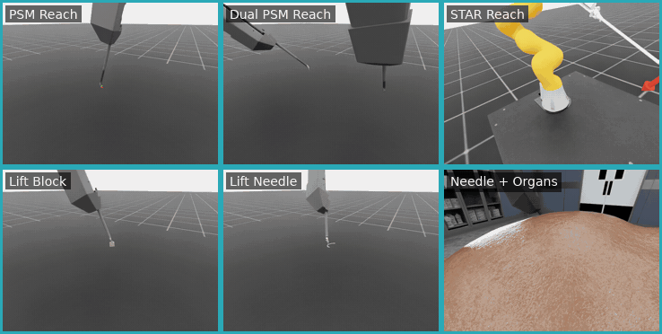

# Laparoscopic Robotics Workflows

These workflows use dVRK PSM or STAR robots for laparoscopic manipulation and instrument positioning.

## Workflows

Each workflow is an [IsaacLab-Arena](https://github.com/isaac-sim/IsaacLab-Arena) environment run by Arena's policy runner with an i4h rule-based policy. The environment classes live in [`i4h_arena.environments`](../../arena/i4h_arena/environments.py) and the policies in [`i4h_arena.policies`](../../arena/i4h_arena/policies/).

| Workflow | Demonstration | Environment (class, name) | Rule-based policy (`i4h_arena.policies.`) |
| --- | --- | --- | --- |
| `surgical_reach_psm` | One dVRK PSM reaches a target. | `PsmReach`, `psm_reach` | `reach.CartesianReachPolicy` |
| `surgical_reach_dual_psm` | Two dVRK PSM arms reach separate targets in parallel. | `DualPsmReach`, `dual_psm_reach` | `reach.CartesianReachPolicy` |
| `surgical_reach_star` | A STAR arm reaches a target. | `StarReach`, `star_reach` | `reach.CartesianReachPolicy --duration_s 0.01` |
| `surgical_lift_block` | A dVRK PSM grasps and lifts a peg-transfer block. | `PsmBlock`, `psm_block` | `lift.CartesianLiftPolicy` |
| `surgical_lift_needle` | A dVRK PSM grasps and lifts a suture needle. | `PsmNeedle`, `psm_needle` | `lift.CartesianLiftPolicy` |
| `surgical_lift_needle_organs` | A dVRK PSM lifts a suture needle from an organ bed. | `PsmNeedleOrgans`, `psm_needle_organs` | `lift.CartesianLiftPolicy --position_tolerance 0.07` |

An episode succeeds when every tool tip is within its radius of the sampled target (1 cm, STAR 3 cm) or when the object is lifted above its success height, and ends then or at its 5 s time-out.

## Demonstrations

Open the preview to view the animated demonstration.

| Rule-based workflow evaluations |
| :---: |
| [](images/surgical-workflows.gif) |

Note: Complete the [project setup](../../README.md#setup-from-the-command-line) before you begin.

## Run with an AI Agent

Paste any prompt into Claude Code, Codex, or the repository's [Local Agent](../../local-agent/README.md):

```text
Run surgical_reach_psm in rule-based mode for 1 episode.

Run surgical_reach_dual_psm in rule-based mode for 1 episode.

Run surgical_reach_star in rule-based mode for 1 episode.

Run surgical_lift_block in rule-based mode for 1 episode.

Run surgical_lift_needle in rule-based mode for 1 episode.

Run surgical_lift_needle_organs in rule-based mode for 1 episode.
```

The agent runs the selected workflow, verifies the episode result, and inspects its recorded artifacts.

## Run from the Command Line

Run from the repository root. Arena's runner takes policy flags before the environment name and environment flags after it.

```bash
# Reach a target with one dVRK PSM for 3 episodes and record them to runs/psm_reach/demos.hdf5.
arena/.venv/bin/python -m isaaclab_arena.evaluation.policy_runner \
  --policy_type i4h_arena.policies.reach.CartesianReachPolicy --num_episodes 3 --enable_cameras \
  --external_environment_class_path i4h_arena.environments:PsmReach psm_reach \
  --recorder_dataset_export_dir_path runs/psm_reach --recorder_dataset_filename demos
```

Swap the policy and environment from the table for the other workflows. Common additions:

- `--viz kit` opens the viewport; `--seed N` fixes the randomization; `--presets newton` runs on Newton.
- `--policy_type i4h_arena.policies.hold.HoldPolicy` holds the arm still to look at a scene.
- Each run writes per-episode results to `outputs/<time>/episode_results_rank0.jsonl` (`--output_base_dir` to move it). Recordings use the Isaac Lab dataset format and keep every episode with its `success` flag.

Replay a recording with Isaac Lab's tool:

```bash
arena/.venv/bin/python third_party/IsaacLab-e3f7d9f/scripts/tools/replay_demos.py \
  --external_callback isaaclab_arena.environments.isaaclab_interop.environment_registration_callback \
  --external_environment_class_path i4h_arena.environments:PsmReach --task psm_reach \
  --dataset_file runs/psm_reach/demos.hdf5
```

Replay restores each episode's initial scene state and steps its recorded actions. Reach targets are sampled commands rather than scene state, so a replayed reach drives the same arm motion toward a newly sampled target.

## 📚 Citations

This workflow originated from the [ORBIT-Surgical](https://orbit-surgical.github.io/) framework. If you use it in academic publications, please cite:

```text
@inproceedings{ORBIT-Surgical,
  author={Yu, Qinxi and Moghani, Masoud and Dharmarajan, Karthik and Schorp, Vincent and Panitch, William Chung-Ho and Liu, Jingzhou and Hari, Kush and Huang, Huang and Mittal, Mayank and Goldberg, Ken and Garg, Animesh},
  booktitle={2024 IEEE International Conference on Robotics and Automation (ICRA)},
  title={ORBIT-Surgical: An Open-Simulation Framework for Learning Surgical Augmented Dexterity},
  year={2024},
  pages={15509-15516},
  doi={10.1109/ICRA57147.2024.10611637}
}

@inproceedings{SuFIA-BC,
  author={Moghani, Masoud and Nelson, Nigel and Ghanem, Mohamed and Diaz-Pinto, Andres and Hari, Kush and Azizian, Mahdi and Goldberg, Ken and Huver, Sean and Garg, Animesh},
  booktitle={2025 IEEE International Conference on Robotics and Automation (ICRA)},
  title={SuFIA-BC: Generating High Quality Demonstration Data for Visuomotor Policy Learning in Surgical Subtasks},
  year={2025},
  pages={4534--4541},
  publisher={IEEE},
  doi={10.1109/ICRA55743.2025.11127797}
}
```
