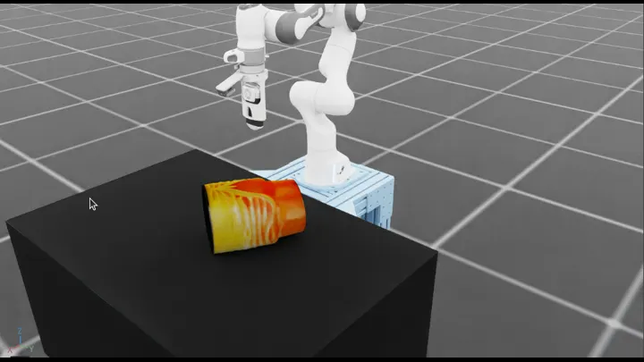

# Ultrasound Robotics Workflows

Workflows for robot-assisted ultrasound probe positioning and scanning.

## Workflows

| Workflow | Demonstration | How it runs |
| --- | --- | --- |
| `ultrasound_liver_scan` | Move an ultrasound probe across an abdominal phantom. | IsaacLab-Arena environment `PandaPhantom` (`panda_phantom`): PI0 policy, rule-based sweep, keyboard teleop, replay ([commands](#liver-scan)) |
| `ultrasound_probe_reach` | Align an ultrasound probe with a randomized target. | IsaacLab-Arena environment `UltrasoundProbeReach` (`ultrasound_probe_reach`); evaluate a trained RSL-RL checkpoint with Arena's `rsl_rl` policy (see below) |

## Demonstrations

Open the preview to view the animated demonstration.

| `ultrasound_liver_scan` |
| :---: |
| [](images/ultrasound_liver_scan.gif) |

Note: Complete the [project setup](../../README.md#setup-from-the-command-line) before you begin.

## Liver Scan

`ultrasound_liver_scan` runs as the IsaacLab-Arena environment `PandaPhantom` (`panda_phantom`). Each episode starts with the probe pointing down above a randomly placed phantom and succeeds once the probe has made contact and scanned across it; it times out after 250 steps. Run it with `./run.sh` from the repository root. Each run opens a Kit window unless you pass `--headless`, and `./run.sh show` prints the underlying commands:

```bash
# Sweep the phantom with the rule-based controller for 3 episodes.
./run.sh ultrasound_liver_scan --rule-based --episodes 3
```

The PI0 checkpoint, `nvidia/Liver_Scan_Pi0_Cosmos_Rel`, runs in its own openpi environment; `i4h_tasks.openpi_pi0.serve` serves it on openpi's websocket protocol, and Arena's openpi client drives the environment. `run.sh` starts the server, which downloads the checkpoint on first use and compiles it before it listens, runs the episodes, and stops it afterwards; pass `--checkpoint` for a locally trained one:

```bash
./run.sh ultrasound_liver_scan --policy --episodes 5
```

Add `--record` to record the episodes into `demos.hdf5` in the run directory, or `--record <path>.hdf5`.

Drive the probe with the keyboard (`W/S/A/D/Q/E` move, `Z/X/T/G/C/V` rotate, `R` resets) and record successful demonstrations with Isaac Lab's `record_demos.py`:

```bash
./run.sh ultrasound_liver_scan --teleop --episodes 1
```

Replay a recording with Isaac Lab's `replay_demos.py`, which runs without cameras (see [Hospital Automation Robotics](hospital-automation-robotics.md#g1-loco-manipulation)):

```bash
./run.sh ultrasound_liver_scan --replay <recording> -- --validate_success_rate
```

[`scripts/e2e/run.sh`](../../scripts/e2e/run.sh) runs the whole data-to-policy loop on this environment: record PI0 episodes, augment, grade them with a vision model against the scene's `annotate` criterion, replay, convert to LeRobot, finetune PI0, and validate the finetuned checkpoint.

## RL Training

`ultrasound_probe_reach` supports the maintained RSL-RL PPO training profile. A trained checkpoint is not included; train one, then evaluate it as a policy in the environment.

### Train with an AI Agent

```text
Train ultrasound_probe_reach with RL.
Evaluate 20 episodes and validate the exported policy.
```

The agent dry-runs, trains, evaluates, exports, and validates the policy.

### Train from the Command Line

Run the complete training lifecycle:

```bash
# Inspect the maintained RSL-RL PPO profile.
./train.sh rl show ultrasound_probe_reach

# Dry-run the training configuration.
./train.sh rl ultrasound_probe_reach \
  --num-envs 128 \
  --epochs 400 \
  --dry-run

# Train the policy from scratch.
./train.sh rl ultrasound_probe_reach \
  --num-envs 128 \
  --epochs 400

# Copy the timestamped run directory printed by the training command.
TRAIN_RUN="$PWD/runs/ultrasound_probe_reach/YYYYMMDD_HHMMSS"

# Evaluate the trained checkpoint.
./train.sh rl ultrasound_probe_reach \
  --eval \
  --checkpoint "$TRAIN_RUN/model_final.pt" \
  --episodes 20

# Evaluate the checkpoint as a policy in the environment with IsaacLab-Arena's runner.
# Arena's rsl_rl policy reads params/agent.yaml beside the checkpoint, which the
# timestamped Isaac Lab log directory inside the run holds.
./run.sh ultrasound_probe_reach --policy --episodes 20 \
  --checkpoint "$(ls -d "$TRAIN_RUN"/20*/ | tail -1)model_399.pt"

# Optionally export the policy as TorchScript (policy.pt, with policy.json) for deployment.
./train.sh rl export ultrasound_probe_reach \
  --checkpoint "$TRAIN_RUN/model_final.pt" \
  --output-dir "$TRAIN_RUN/exported"
```

The policy mode runs Arena's `rsl_rl` policy on the flat observations the policy was trained on (`--rl_observations`). Add `--headless` to evaluate without the viewport.

RSL-RL training and its vectorized evaluation are a separate lifecycle in `rl/`; the trained checkpoint returns to the policy runner for evaluation in the environment.
