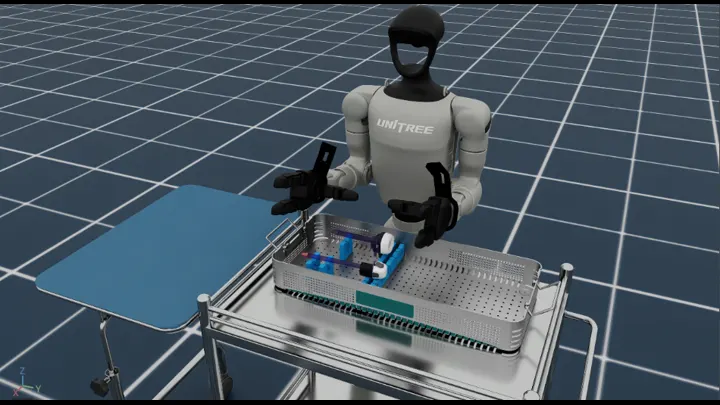
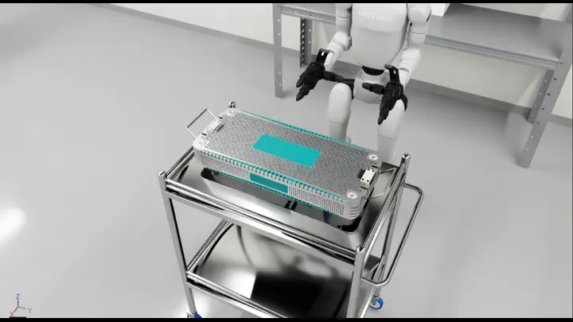
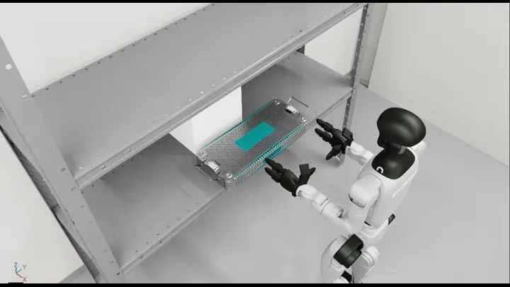
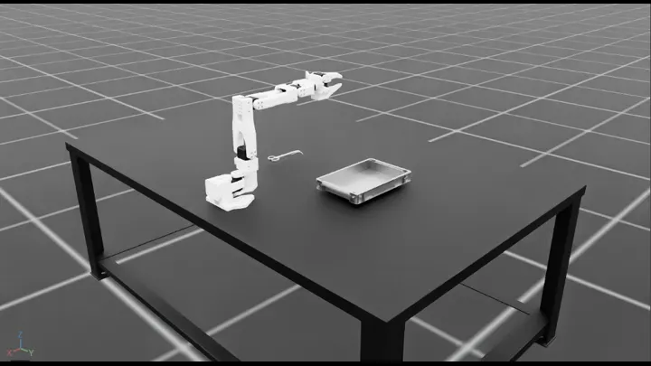
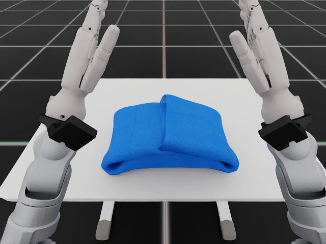
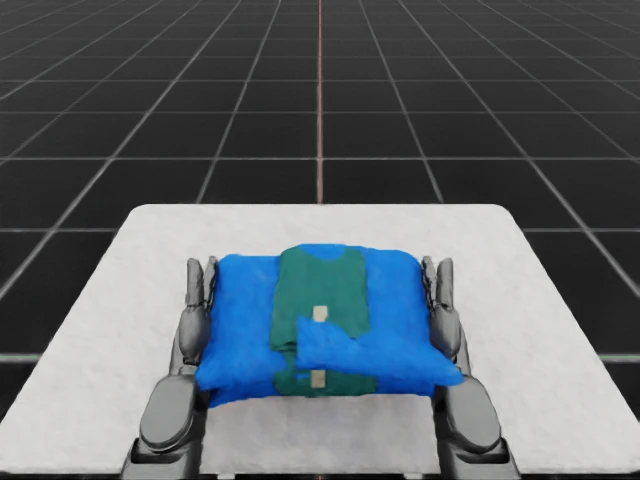

# Hospital Automation Robotics Workflows

Workflows for robotic manipulation, transport, and procedural support in hospital environments.

## Workflows

| Workflow | Demonstration | Supported modes ([guide](../../i4h_workflow_modes/README.md)) |
| --- | --- | --- |
| `assemble_trocar` | Lift, align, insert, place, and release a trocar with a Unitree G1. | IsaacLab-Arena environment `G1Trocar` (`g1_trocar`): GR00T N1.5 policy, replay ([commands](#assemble-trocar)) |
| `locomanip_push_cart` | Walk to a cart, grip it, and push it forward with a Unitree G1. | IsaacLab-Arena environment `G1Cart` (`g1_cart`): GR00T N1.6 policy, keyboard teleop, replay ([commands](#g1-loco-manipulation)) |
| `locomanip_tray_pick_and_place` | Move a surgical tray from a shelf to a cart with a Unitree G1. | IsaacLab-Arena environment `G1Tray` (`g1_tray`): GR00T N1.6 policy, keyboard teleop, replay ([commands](#g1-loco-manipulation)) |
| `scissor_pick_and_place` | Pick up surgical scissors, place them in a tray, and return an SO-ARM 101 home. | IsaacLab-Arena environment `SoarmScissors` (`soarm_scissors`): GR00T N1.5 or N1.7 policy, rule-based keyframes, keyboard or leader-arm teleop, replay ([commands](#scissor-pick-and-place)) |
| `spread_tablecloth_g1` | Spread a deformable tablecloth with Unitree G1 and Inspire hands. | IsaacLab-Arena environment `G1Tablecloth` (`g1_tablecloth`): XR teleop, replay ([guide](../../../docs/workflows/tablecloth.md)) |
| `spread_tablecloth_h2` | Spread a deformable tablecloth with Unitree H2 and Sharpa Wave hands. | IsaacLab-Arena environment `H2Tablecloth` (`h2_tablecloth`): XR teleop, replay ([guide](../../../docs/workflows/tablecloth.md)) |

See [tablecloth XR setup and recording](../../../docs/workflows/tablecloth.md).

`policy_n17` is a workflow-specific extension for an alternative policy stack.

## Demonstrations

Open a preview to view the animated demonstration.

| `assemble_trocar` | `locomanip_push_cart` |
| :---: | :---: |
| [](../../../docs/workflows/images/assemble_trocar.gif) | [](../../../docs/workflows/images/locomanip_push_cart.gif) |

| `locomanip_tray_pick_and_place` | `scissor_pick_and_place` |
| :---: | :---: |
| [](../../../docs/workflows/images/locomanip_tray_pick_and_place.gif) | [](../../../docs/workflows/images/scissor_pick_and_place.gif) |

Tablecloth camera screenshots from simulator validation:

| `spread_tablecloth_g1` | `spread_tablecloth_h2` |
| :---: | :---: |
| [](../../../docs/workflows/images/spread_tablecloth_g1.webp) | [](../../../docs/workflows/images/spread_tablecloth_h2.webp) |

Note: Complete the [project setup](../../../README.md#setup-from-the-command-line) before you begin.

## Scissor Pick and Place

`scissor_pick_and_place` runs as the IsaacLab-Arena environment `SoarmScissors` (`soarm_scissors`). An episode succeeds once the scissors have settled in the tray and the arm is back home; it times out after 600 steps. From the repository root:

```bash
# Pick and place the scissors with the rule-based joint keyframes for 3 episodes.
# The controller reads no camera; add --enable_cameras to record the views.
arena/.venv/bin/python -m isaaclab_arena.evaluation.policy_runner \
  --policy_type i4h_arena.policies.scissors.ScissorPickPlacePolicy --num_episodes 3 \
  --external_environment_class_path i4h_arena.environments:SoarmScissors soarm_scissors
```

The GR00T N1.5 checkpoint, `nvidia/SO_ARM_Starter_Gr00t`, works in the arm's LeRobot joint calibration; `i4h_tasks.gr00t_n15.serve` serves it, and `Gr00tN15RemotePolicy` converts the joints both ways:

```bash
# Start the policy server (terminal 1); pass --model-path for a local or finetuned checkpoint.
tasks/gr00t_n15/.venv/bin/python -m i4h_tasks.gr00t_n15.serve scissor_pick_and_place --port 5555

# Evaluate it for 3 episodes (terminal 2). Add --viz kit to watch.
arena/.venv/bin/python -m isaaclab_arena.evaluation.policy_runner \
  --policy_type i4h_arena.policies.gr00t_n15.Gr00tN15RemotePolicy --embodiment so101_scissors \
  --remote_port 5555 --num_episodes 3 --enable_cameras \
  --external_environment_class_path i4h_arena.environments:SoarmScissors soarm_scissors
```

The GR00T N1.7 checkpoint, `nvidia/SO_ARM_Starter_Gr00tN17`, runs on GR00T 1.7's own inference server; `i4h_tasks.gr00t_n17.serve` registers its modality config before starting it, and `Gr00tN17RemotePolicy` speaks GR00T's client protocol. Its backbone, `nvidia/Cosmos-Reason2-2B`, is gated on Hugging Face: request access on the model page with the account `hf auth login` uses.

```bash
tasks/gr00t_n17/.venv/bin/python -m i4h_tasks.gr00t_n17.serve scissor_pick_and_place --port 5555

arena/.venv/bin/python -m isaaclab_arena.evaluation.policy_runner \
  --policy_type i4h_arena.policies.gr00t_n17.Gr00tN17RemotePolicy --embodiment so101_scissors \
  --remote_port 5555 --num_episodes 3 --enable_cameras \
  --external_environment_class_path i4h_arena.environments:SoarmScissors soarm_scissors
```

Teleoperate the arm and record successful demonstrations with Isaac Lab's tool. With `--teleop_device keyboard`, `W/S/A/D/Q/E/Z/X/T/G` step the five arm joints and `K` toggles the jaw; with `--teleop_device so101_leader --leader_port /dev/ttyACM1`, the arm mirrors an SO-ARM 101 leader arm:

```bash
arena/.venv/bin/python third_party/IsaacLab-e3f7d9f/scripts/tools/record_demos.py \
  --external_callback isaaclab_arena.environments.isaaclab_interop.environment_registration_callback \
  --external_environment_class_path i4h_arena.environments:SoarmScissors --task soarm_scissors \
  --teleop_device keyboard --enable_cameras --viz kit \
  --dataset_file runs/scissor_pick_and_place/teleop.hdf5 --num_demos 1
```

Replay a recording with `scripts/tools/replay_demos.py` as in [G1 Loco-manipulation](#g1-loco-manipulation), using `--external_environment_class_path i4h_arena.environments:SoarmScissors --task soarm_scissors`. [`scripts/e2e/run.sh`](../../../scripts/e2e/run.sh) runs the data-to-policy loop on this environment: record N1.5 episodes, augment, grade, replay, convert to LeRobot, finetune, and validate the finetuned checkpoint.

## G1 Loco-manipulation

`locomanip_push_cart` and `locomanip_tray_pick_and_place` run as IsaacLab-Arena environments (`G1Cart`, `G1Tray` in [`i4h_arena.environments`](../../../arena/i4h_arena/environments.py)). Each task's description is the instruction its GR00T N1.6 checkpoint was trained on, and Arena's runner passes it to the policy.

| Workflow | Environment | Checkpoint |
| --- | --- | --- |
| `locomanip_push_cart` | `G1Cart`, `g1_cart` | `nvidia/GR00T-N1.6-Rheo-Sim-PushCart` @ `0e24b9b225da4a2cff53049eb8b6e57f435814ec` |
| `locomanip_tray_pick_and_place` | `G1Tray`, `g1_tray` | `nvidia/GR00T-N1.6-Rheo-PickNPlaceTray` @ `76a205040fc8489de91487c82e51eecb82f7d250` |

GR00T runs in its own environment with GR00T's server; the simulator uses Arena's GR00T client. From the repository root:

```bash
# Download the checkpoint once and start the policy server (terminal 1).
tasks/gr00t_n16/.venv/bin/hf download nvidia/GR00T-N1.6-Rheo-Sim-PushCart \
  --revision 0e24b9b225da4a2cff53049eb8b6e57f435814ec --local-dir data/models/GR00T-N1.6-Rheo-Sim-PushCart
tasks/gr00t_n16/.venv/bin/python third_party/Isaac-GR00T-1.6/gr00t/eval/run_gr00t_server.py \
  --model-path data/models/GR00T-N1.6-Rheo-Sim-PushCart --embodiment-tag NEW_EMBODIMENT --port 5555

# Evaluate it for 5 episodes (terminal 2). Add --viz kit to watch.
arena/.venv/bin/python -m isaaclab_arena.evaluation.policy_runner \
  --policy_type isaaclab_arena_gr00t.policy.gr00t_remote_closedloop_policy.Gr00tRemoteClosedloopPolicy \
  --policy_config_yaml_path tasks/gr00t_n16/config/g1_locomanipulation.yaml --remote_port 5555 \
  --num_episodes 5 --enable_cameras \
  --external_environment_class_path i4h_arena.environments:G1Cart g1_cart
```

The tray works the same way with its checkpoint and `G1Tray g1_tray`. Each episode ends on the task's success term or after 1,800 (cart) or 1,500 (tray) steps.

Teleoperate the G1 with the keyboard and record successful demonstrations with Isaac Lab's tool. The Pink IK embodiment takes the 23-value whole-body command the keyboard produces (`0` both hands, `1`/`2` one hand, `3` walking, `4` torso, `5` height; `W/S/A/D/Q/E` move, `K/J` close and open the hands, `R` resets):

```bash
arena/.venv/bin/python third_party/IsaacLab-e3f7d9f/scripts/tools/record_demos.py \
  --external_callback isaaclab_arena.environments.isaaclab_interop.environment_registration_callback \
  --external_environment_class_path i4h_arena.environments:G1Cart --task g1_cart \
  --embodiment g1_locomanip_wbc_pink --teleop_device keyboard_23d --enable_cameras --viz kit \
  --dataset_file runs/g1_cart/teleop.hdf5 --num_demos 1
```

Replay a recording, from its recorded initial state, with `scripts/tools/replay_demos.py` and the same `--external_callback`, `--external_environment_class_path` and `--task`, plus `--dataset_file <recording> --validate_success_rate`. Replay without `--enable_cameras`: Arena's registration callback starts Kit before Isaac Lab can enable camera rendering, so camera sensors fail to initialize. Watch the scene without a policy with `--policy_type i4h_arena.policies.hold.HoldPolicy --viz kit --num_episodes 1`.

## Assemble Trocar

`assemble_trocar` runs as the IsaacLab-Arena environment `G1Trocar` (`g1_trocar`), whose success term is the fifth milestone: both trocars lifted, aligned, inserted, placed and released. An episode times out after 250 steps.

The checkpoint, `nvidia/GR00T-N1.5-RL-Rheo-AssembleTrocar` @ `b54e14286ed3f8392d614741748739e09c7fefe4`, needs its own data config and preprocessing, so `i4h_tasks.gr00t_n15.serve` loads it and serves it with GR00T 1.5's `RobotInferenceServer`. The simulator connects with `i4h_arena.policies.gr00t_n15.Gr00tN15RemotePolicy`:

```bash
# Start the policy server (terminal 1). It downloads the pinned checkpoint on first use;
# pass --model-path for a local or exported one.
tasks/gr00t_n15/.venv/bin/python -m i4h_tasks.gr00t_n15.serve assemble_trocar --port 5555

# Evaluate it for 4 episodes (terminal 2). Add --viz kit to watch.
arena/.venv/bin/python -m isaaclab_arena.evaluation.policy_runner \
  --policy_type i4h_arena.policies.gr00t_n15.Gr00tN15RemotePolicy --remote_port 5555 \
  --num_episodes 4 --enable_cameras \
  --external_environment_class_path i4h_arena.environments:G1Trocar g1_trocar
```

Record the episodes with `--recorder_dataset_export_dir_path <dir> --recorder_dataset_filename <name>` after the environment name, and replay one with Isaac Lab's `scripts/tools/replay_demos.py` as in [G1 Loco-manipulation](#g1-loco-manipulation), using `--external_environment_class_path i4h_arena.environments:G1Trocar --task g1_trocar`.

## Assemble Trocar RL Post-training

Start with a GR00T N1.5 checkpoint fine-tuned for Trocar. It must contain `new_embodiment` modality and normalization metadata. The unadapted `nvidia/GR00T-N1.5-3B` base model lacks this metadata and cannot be used directly.

### Train with an AI Agent

```text
RL post-train assemble_trocar with this checkpoint:
  /absolute/path/to/gr00t-checkpoint
Evaluate and export the result, then validate the workflow.

RL post-train assemble_trocar with the pinned
  nvidia/GR00T-N1.5-RL-Rheo-AssembleTrocar checkpoint from Hugging Face.
Evaluate and export the result, then validate the workflow.
```

The agent dry-runs, trains, evaluates, exports, and validates the policy.

### Train from the Command Line

Choose a starting checkpoint, then run the training preflight:

```bash
# Option 1: use an existing downloaded checkpoint.
GR00T_MODEL_DIR=/absolute/path/to/gr00t-checkpoint

# Option 2: download the workflow's compatible Trocar checkpoint.
# tasks/gr00t_n15/.venv/bin/hf download nvidia/GR00T-N1.5-RL-Rheo-AssembleTrocar \
#   --revision b54e14286ed3f8392d614741748739e09c7fefe4 \
#   --local-dir ./data/models/GR00T-N1.5-RL-Rheo-AssembleTrocar
# GR00T_MODEL_DIR="$PWD/data/models/GR00T-N1.5-RL-Rheo-AssembleTrocar"

./train.sh rl assemble_trocar \
  --model-path "$GR00T_MODEL_DIR" \
  --num-envs 64 \
  --epochs 1000 \
  --dry-run
```

The dry run checks checkpoint embodiment metadata and whether the rollout samples divide evenly into PPO batches. Training disables automatic episode recording. `RLINF_TIMEOUT` defaults to 720 minutes; set it explicitly to override the collective timeout for your rollout duration.

Trocar training requires two visible GPUs: one for GR00T N1.5/RLinf and one for Isaac Sim/Arena. After the dry run passes, remove `--dry-run` to train. Then evaluate and export the generated run bundle:

```bash
# Copy the timestamped run directory printed by the training command.
TRAIN_RUN="$PWD/runs/assemble_trocar/YYYYMMDD_HHMMSS"

./train.sh rl assemble_trocar \
  --eval \
  --checkpoint "$TRAIN_RUN" \
  --video
./train.sh rl export assemble_trocar \
  --checkpoint "$TRAIN_RUN" \
  --output-dir "$TRAIN_RUN/exported"
tasks/gr00t_n15/.venv/bin/python -m i4h_tasks.gr00t_n15.serve assemble_trocar \
  --model-path "$TRAIN_RUN/exported" --port 5555
```

Then evaluate the exported policy with the `policy_runner` command in [Assemble Trocar](#assemble-trocar).

RLinf PPO post-training is a separate training lifecycle, not a workflow run mode.

Across RLinf profiles, optional training and periodic evaluation recordings warn on encoder or writer-close failures. Standalone evaluation requires a decodable video when requested with `--video` or effective `env.eval.video_cfg.save_video=true`; video failures return nonzero with a video diagnostic. `--set` uses Hydra 1.3.2 in both dry-run preflight and launch, including `+` additions and `++` forced overrides.
